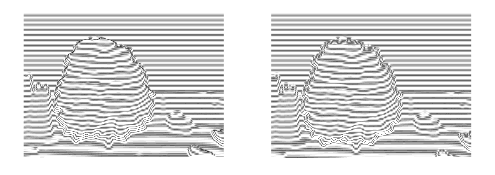

# plotter-art

Line art for pen plotters, generated from raster images and written as
A4 SVG. Plain Rust with no dependencies: PNG decoding, inflate, sampling
and SVG output are all in `src/`.

## Relief from a depth map

Parallel lines are displaced across their direction by depth, so they
rise over anything near the camera and settle back to parallel over the
background. Bright pixels are near. `--lift` is how far white is displaced
relative to black, as a fraction of the image width. There are two styles:

- `offset` (left) lifts each line by its own depth and draws front to
  back with a floating horizon, so raised lines hide those behind them.
- `contour` (right) draws level sets of across + lift·depth. Lines are
  pushed aside and bunch up at silhouettes, but never cross.

      cargo run --release --bin relief -- depth/per.png output/per.svg \
          --style offset --lift 0.05 --lines 120 --angle 0 --blur 4

## Density lines

Random lines start at uniform positions heading roughly toward the center
(`--spread` degrees of jitter) and turn toward darker areas of a
grayscale image, so line density follows darkness. `--pull` sets how hard
they turn, and `--blur` (pixels) how far away dark areas are felt.

    cargo run --release --bin density -- photo.png output/photo.svg \
        --lines 800 --length 300 --pull 15 --blur 20 --seed 1

Inputs are scaled down to at most 1024 pixels on the long side, and all
pixel parameters are in that working resolution. Preview an SVG with
`rsvg-convert -b white -w 1200 out.svg -o out.png`.

## Tests

    cargo test
